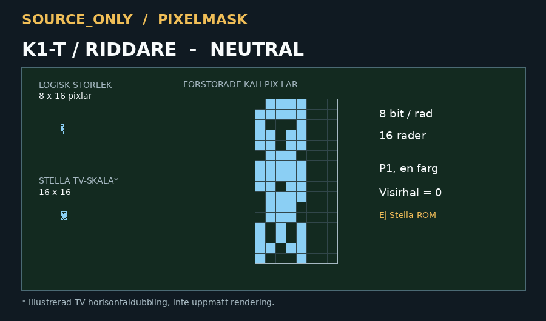
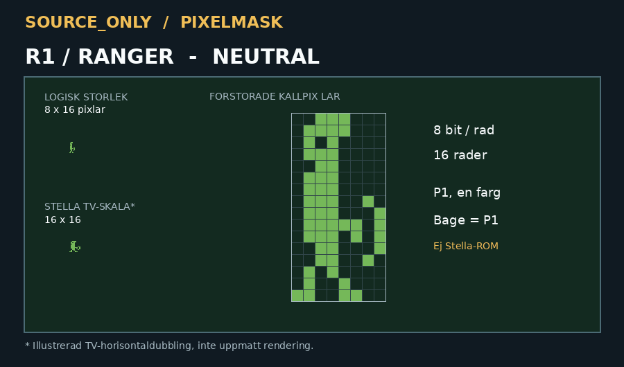
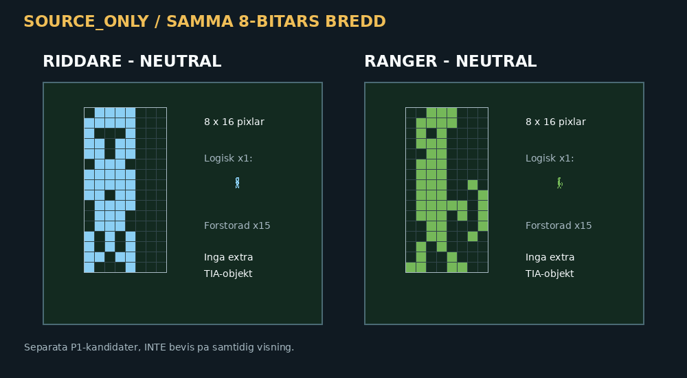

# THE SKRAUN — GRAPHICS II → MAIN IV, source-only enemy art
**2026-11-22 — PROVISIONAL_SOURCE_ONLY, awaiting user visual approval.**

Explicit authorization: MAIN IV user's second graphics work order (T-visor knight, bow Ranger). No ROM, Stella, independent verification, canon change, new world art or merge. Prior forest design **A_Glanta is unchanged**.

## Source provenance
- [Design decisions 01–60](https://github.com/Odourman/the-skraun/blob/main/docs/DESIGN_DECISIONS_01-60_2026-11-16.md), blob `415b66a9603e9330de53768b5800f4a23f8e47b2`.
- [Visual direction](https://github.com/Odourman/the-skraun/blob/main/docs/SKRAUN_VISUAL_DIRECTION_2026-11-16.md), blob `ee4180805f1fd4280303608fee7cdc3d29c0d8c2`.
- [Frozen U1-LEG1](https://github.com/Odourman/the-skraun/blob/graphics/u1-leg1-caprine-gait-20261116/graphics/u1_leg1/SOURCE_U1_LEG1.json), blob `48332690d58aecf70d986eeee075dd3156bbf102`. **No source bitmap changed.**
- Earlier [K1_VISIR study](https://github.com/Odourman/the-skraun/blob/graphics/mainiv-forest-knights-source-20261122/graphics/mainiv_forest_knights_20261122/KNIGHT_P1_CANDIDATES.json), blob `5ba39ca942a75239062f3b42f390782df56cdc54`; older [8×12 archer](https://github.com/Odourman/the-skraun/blob/graphics/skraun-v0-3-final-readability-20261116/graphics/skraun_v0_3/ENEMIES_V03.json), blob `61d60a98d214cd83965ec18fe1f8cc48cd58fffb`.
- [GAMEPLAY-1 draft PR #41](https://github.com/Odourman/the-skraun/pull/41), head `7f289a536c375bf760428274280179cfe15a6a62`: physical P1 only one Knight proxy at a time, not a complete 3-enemy renderer.
- User supplied T-visor reference JPG and Ranger GIF inspected locally. GIF has **two 160-ms frames**. New P1 pixel art uses bow silhouette and movement as reference without copying multicolour pixels. Neither original user reference is republished.

## Visual candidates (never Stella images)

### K1-T helmet and sword: 8×16 P1
- T visor is **transparent negative space**: horizontal three-pixel slot (row y2, x1–3) and a vertical one-pixel gap (x2, y3–4). Same single light-blue pixel colour elsewhere (illustrative `COLUP1=$9E`). No horns. Separately readable legs. Exact bit masks below.
- Neutral/jakt: sword tucked near torso; warning: narrow raised sword to x6; strike: horizontal blade/arm reaches x7 inside P1.
- GIF: neutral 320ms, **warning 400ms (24 NTSC frames at nominal 60Hz)**, strike 160ms *illustrative, not gameplay-approved strike window*, neutral 320ms. Actual logic remains warning locks direction, only active sword causes damage, post-swing recovery about 1s, never body contact.
- **Hard limit:** P1 contains at most 8 horizontal bits, so the strike has no pixels beyond x7. Its silhouette reaches three source columns to the right of the neutral body's outermost x4, but this is not free attack reach outside P1. No 6507/TIA proof of a Boxing-like physical extension.

### R1-BOW Ranger: proposed 8×16 P1, 3 poses
- Earlier Ranger was 8×12: this is a *new 8×16 design candidate*, not approved production-height change. Hood/human torso generally 3–4 columns, curved bow on x6–7; draw/release redistributes the string/arm. All bow pixels **belong to P1 itself**, with no extra missile. Arrow is a separate gameplay projectile and is NOT implemented.
- GIF: neutral 320ms, draw 480ms, release 160ms, neutral 320ms; times are visual demonstration, not Ranger firing timings. One colour at a time. World test bytes: forest green `$C6`, dream purple `$58`, mountain tan `$38`, night high-contrast pale `$0C`; all **provisional NTSC palette candidates**, not accepted. Forest PF was `$C8` in the former study, so Ranger contrast needs physical review.
- Whole 8-bit mask can be reversed per row for screen-left. No up/down sprite or new AI/facing rule approved.

## Exact top-first 8-bit masks; bit7 = x0 left, one foreground colour
Each pose has 16 bytes, **48 bytes per actor family before mirroring**. For a conventional bottom-first raster table, reverse **row order**, not bits, as already exported in the ZIP's `data/ENEMY_P1_SOURCE_ONLY.inc`.

| Candidate, pose | 16 hex source bytes, top first |
|---|---|
| Knight neutral | `$78,$F8,$88,$D8,$D8,$70,$F8,$F8,$D8,$78,$70,$70,$A8,$A8,$D8,$88` |
| Knight warning | `$7A,$FA,$8A,$DA,$DA,$72,$FA,$FE,$D8,$78,$70,$70,$A8,$A8,$D8,$88` |
| Knight strike | `$78,$F8,$88,$D8,$D8,$70,$F8,$FC,$DF,$7F,$70,$70,$A8,$A8,$D8,$88` |
| Ranger neutral | `$38,$78,$50,$70,$30,$70,$70,$72,$71,$7D,$75,$31,$32,$50,$48,$CC` |
| Ranger draw | `$38,$78,$50,$70,$32,$71,$75,$79,$7F,$79,$75,$32,$28,$48,$48,$CC` |
| Ranger release | `$38,$78,$50,$70,$32,$71,$71,$71,$7F,$71,$71,$32,$28,$48,$48,$CC` |

A single P1 player can draw 8 logical colour clocks wide, shown on a 320-pixel TV crop as 16 pixels horizontally. The ZIP provides exact transparent `8×16` PNGs plus nearest-neighbour enlarged grid previews. These are source graphics only.

## P1-only vs optional M1
- **A P1-only (source recommendation for first visual test):** all three knight poses fit P1; the active swing looks wider but ends at the P1 right edge. No extra missile. ROM still must test the visual outcome physically.
- **B P1+M1 (unapproved alternate):** M1 could show a longer same-colour blade; TIA missile width normally 1/2/4/8 colour clocks, with its own enable, reset/positioning and scanline cost, sharing P1 colour (`COLUP1`). Not a free extra player and may conflict with simultaneous actor rendering. A drawing of M1 would not prove it works. Alternate illustrated in complete ZIP.
- **Critical full-scene blocker remains:** P0 Skraun + two active knights + Ranger + halo/obstacles/arrow on original 2600, including same-Y overlap and 76 cycles/scanline. These new bitmaps do not solve that. Preserve all gamecanon. Separate MAIN IV order required to task ROM DEVELOPMENT III.

## Reproducibility and package
[Complete SOURCE_ONLY delivery ZIP in this folder](THE_SKRAUN_MAIN_IV_KNIGHT_T_VISOR_RANGER_BOW_SOURCE_ONLY_2026-11-22.zip) includes `generate.py`, `verify.py`, source JSON, binary/hex/bottom-first P1 tables, six exact RGBA 8×16 PNGs, GIFs, all enlarged figures, previous A_Glanta composite, original-reference metadata only, and `SHA256SUMS.txt` with 22 payload entries.

- ZIP **373576 bytes**, SHA-256 `d7632be7d92289a886b81795b8f910847ee17249cd5ea2a7798076ed681d117b`; ZIP CRC PASS, 22 SHA manifest entries PASS.
- Local **SOURCE_ONLY** validation: 6 native masks match original 8×16 pixel bits; 3 GIFs contain four actually differing frames; reused A_Glanta pixels outside characters unchanged; U1-LEG1 frozen source pixels exactly reproduced in composite.
- No DASM, no ROM, no Stella, no independent verification. 
- [Google Drive duplicate ZIP](https://drive.google.com/file/d/1hnwY3T2RjjkeFlDYeLF-TwCLzjedqu6u/view).

**GRAPHICS II recommendation to MAIN IV:** K1-T VISIR and R1-BOW for user visual selection; if sword reach or native Ranger bow is unreadable during a real future ROM trial, compare M1/height options under a separate order. **STOP** here.